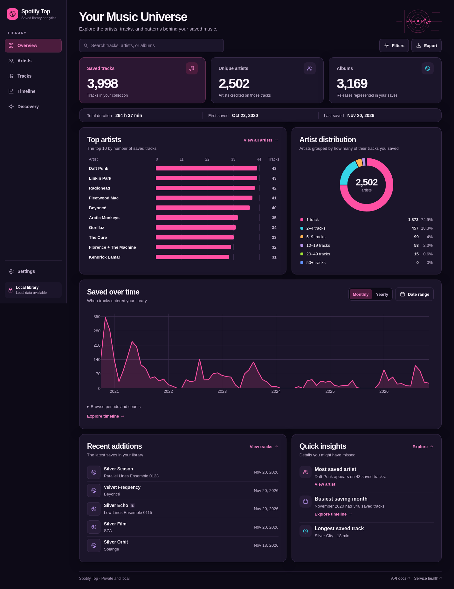
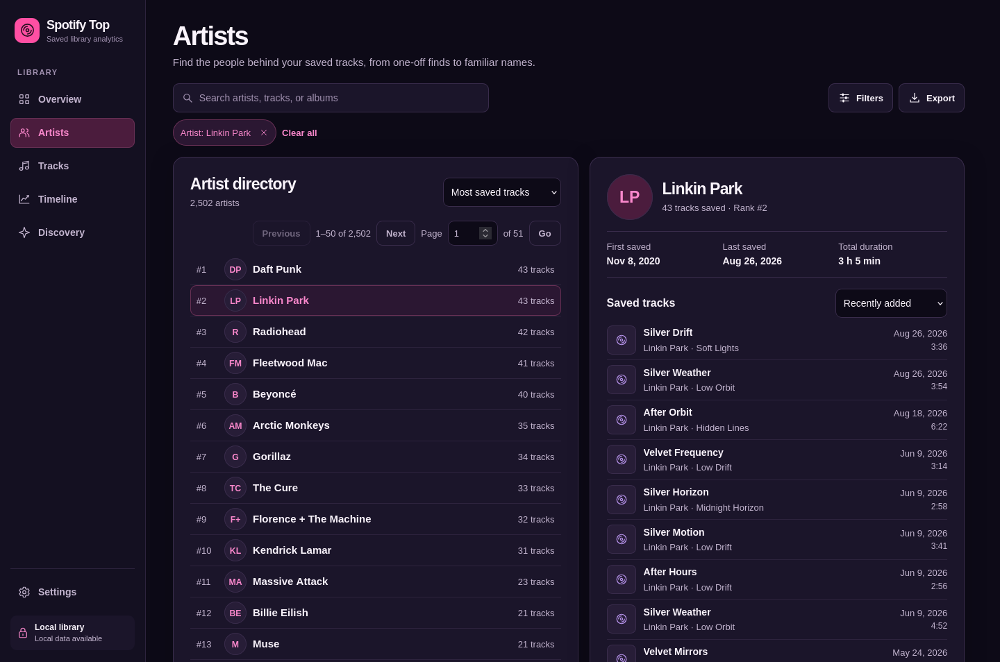
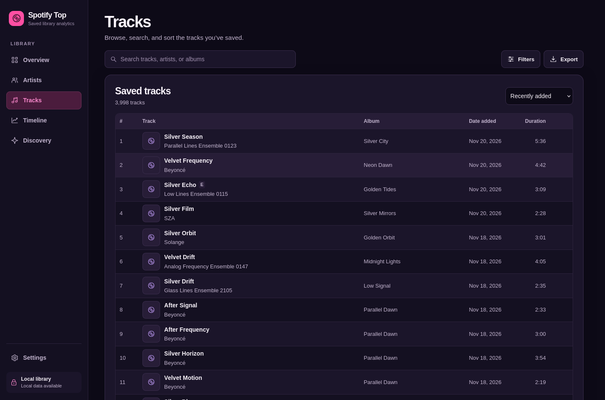
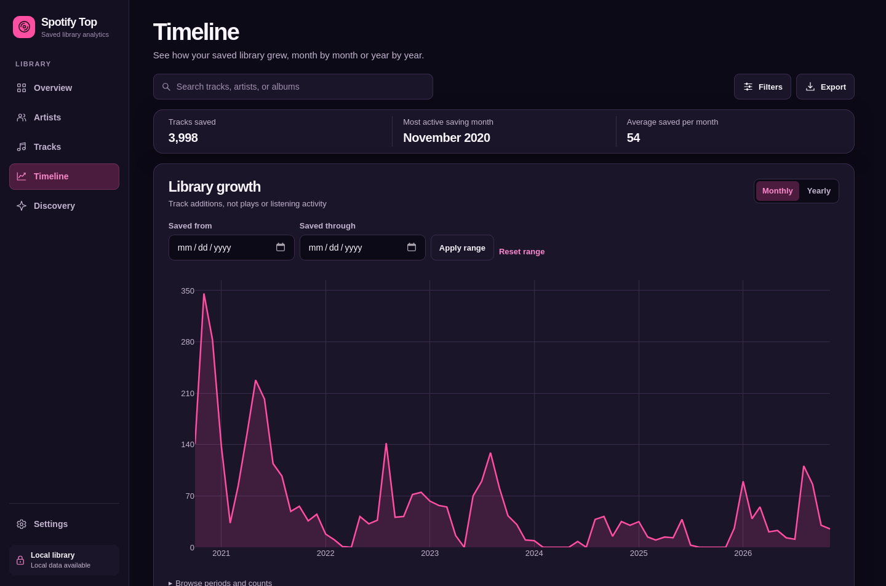
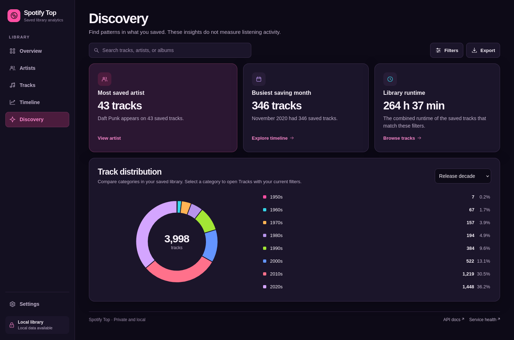
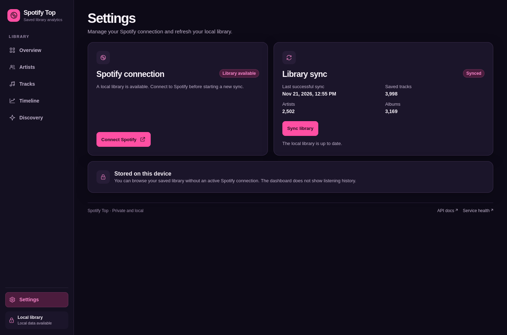

# Spotify Top

A local dashboard for exploring a Spotify saved-track library. Library data and analytics are stored in a local SQLite database. Spotify access is optional: use the isolated demo library without credentials, or connect a Spotify account to import its saved tracks.

## Requirements and setup

Python 3.12 or newer and [uv](https://docs.astral.sh/uv/) are required. From the repository root:

```sh
uv sync
```

Start the dashboard. You do not need a `.env` file or Spotify credentials for this step:

```sh
uv run spotify-analytics
```

The CLI initializes the configured database, starts the server, and opens the dashboard at <http://127.0.0.1:8000/> after server startup is complete. Use `--no-browser` in automation or when opening the URL yourself. `--host` and `--port` override the configured bind address and port:

```sh
uv run spotify-analytics --no-browser
uv run spotify-analytics --host 127.0.0.1 --port 8001
```

The launcher disables Uvicorn access logs so OAuth callback URLs (which may contain authorization codes) are not written to request logs. Do not expose the local app publicly without adding appropriate deployment security.

## Demo mode

Run a deterministic demo library without Spotify credentials:

```sh
uv run spotify-analytics --demo
```

Demo mode derives a separate sibling database file by adding `-demo` before the configured SQLite database suffix. For example, `sqlite:///./data/spotify-analytics.db` uses `./data/spotify-analytics-demo.db`. It initializes and seeds only that file, then serves it. It never writes demo rows to or replaces the configured real-library database. The demo fixture uses account ID `demo`; it is local sample data, not a Spotify account or a sync. `--demo` requires a file-backed SQLite URL.

For one-shot database operations, which exit without serving:

```sh
uv run spotify-analytics --init-db
uv run spotify-analytics --load-demo
```

`--init-db` creates the configured database schema. `--load-demo` initializes and transactionally loads deterministic demo rows into the configured database; the fixture loader is idempotent and refuses to overwrite a nonempty non-demo library. Prefer `--demo` for exploring sample data alongside an existing library.

## Connect Spotify

1. Sign in to the [Spotify Developer Dashboard](https://developer.spotify.com/dashboard). Select **Create app**, enter a name and description, and select **Web API**.
2. In **Redirect URIs**, add `http://127.0.0.1:8000/auth/callback` and save the app. Use `127.0.0.1`, not `localhost`. If you change the port, use the same redirect URI in both Spotify and `.env`.
3. Run `cp .env.example .env` if `.env` does not exist. In the app settings, find the client ID and client secret. Set `SPOTIFY_ANALYTICS_SPOTIFY_CLIENT_ID` and `SPOTIFY_ANALYTICS_SPOTIFY_CLIENT_SECRET` in `.env`.
4. Run `openssl rand -hex 32` and set its output as `SPOTIFY_ANALYTICS_SESSION_SECRET` in `.env`. Keep `.env` private. Do not commit it.
5. Start the app with `uv run spotify-analytics`. Open **Settings**, select **Connect Spotify**, and approve access. Back in **Settings**, select **Sync library**. Authorization alone does not import tracks.

If authorization stops on a callback error page, return to the dashboard and select **Connect Spotify** again. Do not refresh the callback page: authorization codes and login state are only for one login attempt.

Spotify requires a Premium account for the owner of a development-mode app. To permit other Spotify accounts, add them under **Settings → Users Management** in the Spotify Developer Dashboard. Spotify can limit API access and quotas. This project has not been verified with a real Spotify account.
See Spotify's official [Web API getting-started guide](https://developer.spotify.com/documentation/web-api/tutorials/getting-started), [redirect URI rules](https://developer.spotify.com/documentation/web-api/concepts/redirect_uri), and [quota modes](https://developer.spotify.com/documentation/web-api/concepts/quota-modes) for current platform requirements.

The app requests read access to saved tracks and artist follows. Each sync fetches a complete saved-track snapshot and publishes it atomically in SQLite; a failed sync keeps the previous library. OAuth tokens stay in process memory. After a server restart, connect again to sync or see follow status. The local library and its last successful sync time remain available offline. Sync requires Spotify network access. The app does not collect listening history or streaming activity.

## Dashboard

The dashboard provides:

- **Overview:** saved-track, artist, and album counts; total duration and save dates; the top ten artists; artist distribution by saved-track count; the saved-track timeline; and recent additions with artwork and Spotify links where available.
- **Artists:** a directory with 50 artists per page, ranking and name sort, and profiles with saved tracks, dates, total duration, and Spotify links where available. Enter a page number or use its arrows, then select **Go**.
- **Tracks:** a paginated library with album artwork, artist credits, duration, and sorting by save date, title, or duration.
- **Timeline:** monthly or yearly saved-track counts, a selectable date range, and a summary of the busiest month and average additions per month.
- **Discovery:** insights about the top saved artist, busiest saving month, and library duration, plus charts by release decade, duration, or explicit content.
- **Settings:** Spotify connection and sync status, last successful sync, counts, and the action to synchronize the library.

The top-artist list, artist directory, and artist profiles show **Following** or **Not following** for the connected Spotify account. If you already have a saved library, reconnect to approve the new permission. You do not need to sync again. Follow status is hidden in demo mode, when no account is connected, or when Spotify cannot return it.

Use the shared search field to find track, album, or credited artist names. Open **Filters** to set inclusive saved-date bounds, explicit or clean content, or a Spotify album ID. Filters intersect and stay active when you change screens. Remove them with the filter chips or select **Clear all**.

Select a top-artist bar to open that artist. Select a timeline point or use **Browse periods and counts** to open the tracks saved during that period. On Discovery, select an explicit-content category to filter Tracks. Release-decade and duration categories open Tracks without adding a filter. The artist distribution is a summary and does not filter the directory. A track with multiple artists counts once for each credited artist and once in the overall track total.

Use the dashboard download controls to export filtered artists or tracks as CSV, or the full filtered report as JSON. The API routes are `GET /api/export/artists.csv`, `GET /api/export/tracks.csv`, and `GET /api/export/library.json`. These accept the common filter query parameters (`added_from`, `added_to`, `artist_id`, `album_id`, `q`, `explicit`), return all matching results without pagination, and reject unknown query parameters. Downloads are UTF-8 attachments named `artists.csv`, `tracks.csv`, and `library.json`. JSON includes filtered overview, artists, tracks, monthly and yearly timelines, distributions, and insights. CSV text is protected against spreadsheet formulas; JSON keeps the original text.

Analytics run locally against persisted library data; no Spotify connection is required to browse existing data or use demo mode. The charts use a bundled Plotly asset and do not require a chart CDN. Empty libraries show empty states. Saved-track counts, dates, and analytics do not measure plays or listening frequency.

Artist images and album covers can be unavailable offline. The demo uses sample image URLs that do not resolve. The dashboard shows local fallback artwork. These image requests can appear as network errors in browser tools, but do not stop charts or local analytics.

### Screenshots

Firefox screenshots from a library snapshot with substitute artist names, sample track and album titles, and no personal artwork.



<details>
<summary>Artists</summary>



</details>

<details>
<summary>Tracks</summary>



</details>

<details>
<summary>Timeline</summary>



</details>

<details>
<summary>Discovery</summary>



</details>

<details>
<summary>Settings</summary>



</details>

## Settings

Settings are read from `.env` and environment variables prefixed `SPOTIFY_ANALYTICS_`; environment values override `.env`.

| Setting | Environment variable | Default |
|---|---|---|
| Database URL | `SPOTIFY_ANALYTICS_DATABASE_URL` | `sqlite:///./data/spotify-analytics.db` |
| Host | `SPOTIFY_ANALYTICS_HOST` | `127.0.0.1` |
| Port | `SPOTIFY_ANALYTICS_PORT` | `8000` |
| Spotify client ID | `SPOTIFY_ANALYTICS_SPOTIFY_CLIENT_ID` | unset |
| Spotify client secret | `SPOTIFY_ANALYTICS_SPOTIFY_CLIENT_SECRET` | unset |
| OAuth redirect URI | `SPOTIFY_ANALYTICS_REDIRECT_URI` | `http://127.0.0.1:8000/auth/callback` |
| Session signing secret | `SPOTIFY_ANALYTICS_SESSION_SECRET` | unset |

Without Spotify credentials and a secure session secret, Spotify login and sync remain unavailable; local analytics continue to work. For a non-default port, update the redirect URI in both `.env` and the Spotify Developer Dashboard to the exact same URL. The demo database name is derived from the configured database URL as described above.

## Manual smoke procedure

The automated tests use local SQLite fixtures and mock Spotify HTTP responses. They do not require credentials or a network connection. To check the browser locally:

1. Run `uv sync`, then `uv run spotify-analytics --demo`.
2. Confirm the browser opens only after the server is ready, the dashboard loads populated demo views, and Settings identifies the local demo sync state.
3. Stop the demo server and confirm the configured real-library database did not change. Restart with `uv run spotify-analytics --demo --no-browser` and confirm the demo data remains available. Use the normal command to browse a previously synchronized real library.
4. If Spotify credentials are configured, use **Connect Spotify**, complete authorization, and run **Sync library**. Reconnect after restarting the process because tokens are process-local.

## Development

```sh
uv run pytest
uv run ruff check .
```

The frozen database, API, filter, authentication, and synchronization contracts are documented in [docs/contracts.md](docs/contracts.md). Export routes are documented above.
